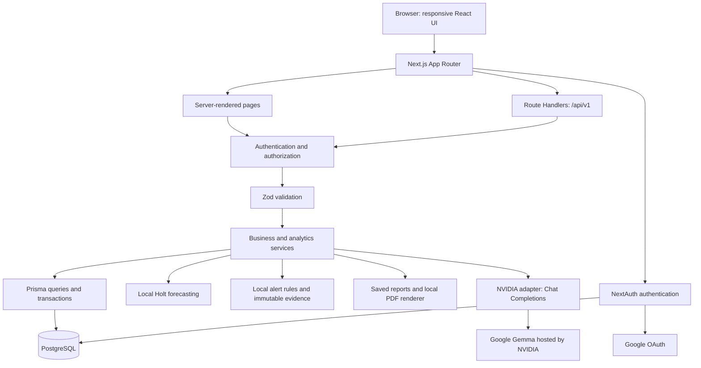

# Architecture

Status: all planned implementation phases through Phase 14 are covered locally. Live Google verification awaits credentials; previous NVIDIA probes timed out and live reliability remains unverified. Phase 13 hardening is described in [HARDENING.md](HARDENING.md). Phase 14 adds an operator-only atomic demo seed, a manual checklist, production environment preflight, optional direct migration connection, Vercel pool lifecycle management and deployment guidance. The user will connect hosting later; no hosted deployment or remote CI success is claimed.

## Foundation implementation

`src/app/(workspace)` contains protected business and record pages. `src/app/(auth)` contains sign-in and registration screens. `requirePageUser()` protects workspace pages; `requireUser(role?)` protects private APIs and future actions. Both use a fresh database identity from the NextAuth session callback. Business/record routes use owner-scoped services. `src/lib/records` holds manual record validation, decimal calculations, snapshot rules, and scoped persistence. Six resources share presentation and an explicit Route Handler allowlist; domain behavior remains explicit in the service branches. See [CORE_RECORDS.md](CORE_RECORDS.md).

Server components render the shell/content. Small client components handle routing state, the Radix dialog for compact navigation, and `next-themes` appearance controls. Source-owned shadcn-style Button, Card, and Skeleton components use shared Tailwind 4 tokens. The brand symbol has theme-aware colors and system fonts, so rendering does not depend on a remote font service.

`getDatabase()` is the server-only lazy database entry point. Its reusable factory configures Prisma 7's standard PostgreSQL adapter with a bounded pool and connection/query timeouts. The schema contains authentication models, shared attempt counters, Business, six core record models, DataImport, ForecastRun/ForecastPoint, ChatConversation/ChatMessage, AlertRule/Alert and Report. See [authentication design](AUTHENTICATION.md) for hashing, session, CSRF, and throttling decisions. The public liveness route does not query or expose database state.

The runtime is Node 24.13+, Next.js 16.3.8, React 19.3, TypeScript 6.0.3, and Prisma 7.10.0. ESLint 10 uses supported TypeScript, Next.js, and React Hooks rule packages directly. See [the Phase 1 report](PHASE_1_FOUNDATION.md) for tested versions and dependency decisions.

## Application boundary

`src/lib/imports` separates bounded multipart input, CSV/XLSX parsing, row validation, signed preview tokens, templates and persistence. Import routes authorize before parsing. Preview uses Repeatable Read; confirmation locks the owned business and revalidates against the reviewed state before atomically saving valid records and DataImport history. No raw upload or mutable preview staging table is retained. The browser displays 25 preview rows at a time; history loads 20 imports per page. See [IMPORTS.md](IMPORTS.md) for matching/idempotency and resource bounds.

Use one Next.js App Router project and one PostgreSQL database. Next.js Route Handlers provide the versioned HTTP API; server-side services own domain rules. Keep the proposed `src/app`, `components`, `lib`, `services`, `repositories`, and `types` structure, adding folders as they gain real implementations.

## Responsibilities

| Layer                | Responsibility                                                                                                     |
| -------------------- | ------------------------------------------------------------------------------------------------------------------ |
| Pages and components | Present data, accessible controls, forms, loading states, responsive layout, themes                                |
| Route Handlers       | Authenticate, authorize, validate, invoke a service, return safe serialized results                                |
| Services             | Business policies, historical cost snapshots, calculations, imports, forecasts, feedback analysis, reports, alerts |
| Repositories         | Business-scoped database queries, pagination, transactions, persistence constraints                                |
| Shared libraries     | Auth helpers, environment validation, money/date utilities, constants, reusable schemas                            |

Server-rendered pages call services directly where useful instead of making HTTP requests back into their own application. Browser mutations use documented REST-style routes. Do not create generic repository frameworks, duplicate service layers, or a separate Express deployment.

Services receive the authenticated actor and target business explicitly. Every public service entry point must enforce its access boundary, including calls outside HTTP handlers. Resource lookups include their business scope. A selected-business cookie or URL is navigation state, never proof of ownership.

## Authentication and isolation

- Use the verified stable NextAuth approach for credentials and Google, with adapter details recorded in the Phase 0 review.
- Persist password users explicitly through a registration service; hash passwords on the server and never select their hashes for client responses.
- Keep session identity distinct from authorization. Read current user status/role on every protected request so suspension takes effect despite an existing session.
- Check business ownership on every business operation, including nested product, category, import, conversation, report, and forecast identifiers.
- Admin access exposes user administration and basic business metadata. It does not grant access to private business content.
- Keep safe OAuth account-linking defaults; do not enable dangerous email-based automatic linking.
- Use auth-framework CSRF protection for its flows and explicit origin/CSRF controls for cookie-authenticated application mutations. A hidden navigation item is not an authorization control.

## Administration implementation

`src/lib/admin` owns allowlisted statistics/directories and status changes. Each service independently reloads active ADMIN authorization; HTTP guards and page guards are additional boundaries. Statistics and list/count pairs use Repeatable Read. Status mutations lock actor/target User rows in ID order, recheck the actor, reject self-changes and compare a database-maintained status version. This preserves an active administrator during competing suspensions while existing owner-only business services remain unchanged. The UI includes a role-gated navigation link and named confirmation dialogs. The operator-only `admin:grant` CLI assigns the role to a specifically named existing active account; no web promotion API exists. See [ADMINISTRATION.md](ADMINISTRATION.md).

## Business implementation

`src/lib/business/service.ts` enforces current active status and ownership for every operation, including calls outside HTTP. Row locks coordinate settings/delete with the financial-write lock helper used by records, imports, forecasts and reports. Versioned edits prevent stale overwrites. `getWorkspaceBusinesses()` is request-scoped and resolves the cookie only against owned profiles; a fresh navigation clears client route state when switching. See [BUSINESSES.md](BUSINESSES.md) for the financial integration contract.

## Data and analytics

`src/lib/reports` creates owner-scoped immutable snapshots under the Business row lock and Repeatable Read. It reuses bounded deterministic dashboard/context calculations, then saves labels, periods, summary, coverage, forecasts and alert evidence. A business/request UUID prevents duplicates. Separate optional AI summaries use saved context only, an independent cooldown, leases and conditional completion outside provider-call transactions. HTML and local React PDF rendering share section definitions; PDF export does not read current records or call NVIDIA. Bundled Latin/Arabic fonts are included in the Next server trace. Saving an empty monetary report also permanently locks currency/timezone. See [REPORTS.md](REPORTS.md).

`src/lib/alerts` separates strict contracts, a pure Decimal rule engine, transaction-scoped evaluation and owner-authorized persistence. Five default rules evaluate completed periods and saved revenue forecasts. Relevant record/import/analysis/forecast writes run evaluation before committing under the same Business row lock. Dashboard/alert refreshes also evaluate; counts and settings reads do not. A unique business/fingerprint key prevents duplicate alerts, and optimistic versions protect rule/status edits. Snapshots retain triggering evidence after data changes. No scheduler, external notification or extra provider call is involved. See [ALERTS.md](ALERTS.md).

`src/lib/forecasting` isolates calendar plans, history coverage, Decimal Holt fitting/evaluation and owner-scoped persistence. Eligibility is a read-only aggregate snapshot. Generation locks the business, rechecks its history hash, requires explicit gap confirmation, enforces recorded-date minimums and saves the run with its points atomically. A unique identity reuses identical runs. Immutable results preserve the historical values, assumptions, daily projections, holdout predictions and model settings. Charts compare daily history with daily predictions; three-month tables sum daily estimates into full future calendar months. Work is bounded to 366 historical dates, 121 parameter pairs and 124 projected days. See [FORECASTING.md](FORECASTING.md).

The implemented `src/lib/dashboard` service authorizes the business, resolves business-local inclusive periods, and runs parameterized PostgreSQL aggregates in a Repeatable Read transaction. Pure Decimal calculations derive both periods' KPIs from daily aggregates. The Overview server component and uncached dashboard GET endpoint share this service. Client Recharts components receive bounded, safe aggregate DTOs; exact-value tables and tooltips retain decimal strings. This adds no schema, background job, or cache. See [DASHBOARD.md](DASHBOARD.md).

PostgreSQL remains replaceable across hosting providers. Use Prisma with standard PostgreSQL connections, provider-independent SQL migrations, and bounded connection pools.

Persist financial values using database Decimal types. Validate decimal strings at API boundaries, calculate with decimal arithmetic, and serialize money as strings. Convert only bounded chart display values to JavaScript numbers. Preserve historical unit costs/prices; do not join current product prices into historical profit calculations.

Use business-local calendar dates for date-only entries and UTC timestamps for audit events. The selected business timezone controls reporting boundaries. Currency and timezone edit policies must protect historical meaning; see the database review.

KPI, alert, forecast, and report services share calculation definitions. Forecasts use Holt's linear trend method and chronological backtesting, with minimum history checks and explicit limitations. Missing observations must be distinguished from known zero activity before forecasting.

Report snapshots contain the values, labels, currency, timezone, and period used at generation. PDFs are rebuilt from snapshots and remain usable when the AI provider is unavailable. Alert fingerprints must be enforced by a database uniqueness constraint to handle concurrent evaluation.

## AI boundary

Phases 8–9 and optional Phase 11 report summaries use server-only NVIDIA configuration wrappers and a shared mockable native-fetch transport in `src/lib/ai/nvidia.ts` for Google Gemma 4 31B IT. This supersedes the initial OpenAI SDK/Responses plan under the user's provider selection. Each feedback request sends one bounded feedback text with a fixed classification prompt, JSON Schema and independent Zod validation. Chat has a separate prompt/schema and bounded aggregate business context; neither feature exposes database tools or unrestricted queries. See [AI_INTEGRATION.md](AI_INTEGRATION.md).

The service claims up to three comments under the owned business lock, performs 60-second-bounded calls outside the transaction, then conditionally saves only current version/token results. A one-minute cooldown and 150-second leases prevent duplicate attempts while allowing crash recovery. Safe failures retain the comment for explicit retry. Provider/model/prompt provenance is retained with results; raw errors and reasoning are not. No provider-retention guarantee is made. Credentials and unrelated content stay out of prompts and logs.

Phase 9 stores owner/business-scoped conversations, paired messages and immutable completed context snapshots in PostgreSQL. `src/lib/assistant/context.ts` reuses the dashboard's transaction-scoped snapshot helper and reads only that business's topic aggregates and latest three saved forecasts. Phase 10 adds up to five non-dismissed historical alerts with their own dates, without evaluating or making additional provider calls. Conversations fix reporting dates at creation and rebuild context before each request. The API never accepts client-supplied context/history; only the latest three completed exchanges are sent. Idempotent turn UUIDs, optimistic versions, per-business cooldowns and token/lease checks protect concurrent sends, retries, deletion and suspension. Calls happen outside transactions. See [BUSINESS_ASSISTANT.md](BUSINESS_ASSISTANT.md).

Application code returns the specified refusal when validated assistant output says `inScope: false`:

> Sorry, I can only help with questions related to your business and the business data available in this system. If you have a business-related question, go ahead.

The fixed response guarantees consistent wording after classification; it cannot guarantee that a model will classify every adversarial prompt correctly. Validate outputs, bound calls, handle refusals/incomplete results, test prompt-injection cases, and fail safely on invalid results. Feedback text is data, not instructions. Failed feedback analysis retains the original row for retry. Use a mockable adapter; automated tests and seeding do not require live API calls.

## Imports and deployment

Imports have an authorized upload, bounded parsing, row validation, preview, explicit confirmation, and transactional persistence with metadata. Revalidate at confirmation; do not trust client-edited previews. Limit file size, expanded workbook content, rows, cells, and text lengths; accept CSV/XLSX only. Do not permanently store raw files or evaluate formulas/macros.

Deploy the application to Vercel and PostgreSQL to a provider such as Neon. Use the Node runtime for database, hashing, spreadsheet, and PDF work. Keep feedback analysis batches and uploads within the chosen hosting plan's verified limits; no long-lived background work should depend on an HTTP request continuing after its response.

CI will install locked dependencies, generate Prisma Client, run lint/typecheck/tests, and build. Database integration tests use isolated PostgreSQL; browser tests cover critical journeys as those features arrive.
