# Database design

Phase 12 adds the tenth migration, `20261010130000_phase_12_admin`, applied to development and test on 2026-10-10. User.statusVersion starts at 1 with a positive constraint. A BEFORE UPDATE trigger advances it only when status changes, including ordinary SQL updates, and prevents independent version rewrites. User and Business gain creation/id listing indexes. Existing roles/statuses and business content are unchanged. Status mutations lock actor/target User rows in sorted order before checking current active ADMIN authorization and the observed version. See [ADMINISTRATION.md](ADMINISTRATION.md).

Phase 11 adds the ninth migration, `20261009230000_phase_11_reports`, applied to development and test. Report stores business-scoped request identity/hash, type, saved name/currency/timezone, inclusive dates, deterministic summary, versioned JSON snapshot and creation time. Optional AI fields retain state, summary/error, provider/model/prompt provenance, attempts, lease token/expiry and completion time. Business.reportSummaryNextAt is its independent cooldown. Unique identity, date/content/state checks, immutable snapshot/completed-summary enforcement and a financial-write trigger protect persistence. Whole-business deletion cascades reports. See [REPORTS.md](REPORTS.md).

Phase 10 adds the eighth migration, `20261009093000_phase_10_alerts`, applied to development and test on 2026-10-09. AlertRule stores five versioned, enabled default rules per business. Alert stores immutable trigger evidence and periods, SHA-256 fingerprints and versioned read/dismiss state. The migration backfills rules for existing businesses, without creating alerts or changing financial records. Composite business/rule references, unique business/fingerprint identity and CHECK constraints protect thresholds, status/timestamps, positive versions, dates and evidence. See [ALERTS.md](ALERTS.md).

Phase 9 adds the seventh migration, `20261009090000_phase_9_business_assistant`, applied to development and test on 2026-10-09. ChatConversation references both User and `Business(id, ownerId)` through `(businessId, userId)`, preventing a conversation owner from differing from its business owner. Conversations store fixed date-only reporting bounds, a positive version and an even message count capped at 100. ChatMessage stores paired USER/ASSISTANT slots, immutable completed context snapshots, validated replies, safe failure codes, provenance, attempts and private leases. Business.assistantNextAt is the independent chat cooldown. See [BUSINESS_ASSISTANT.md](BUSINESS_ASSISTANT.md).

Phase 8 adds the sixth migration, `20261008120000_phase_8_feedback_analysis`, applied to development and test on 2026-10-08. CustomerFeedback now also stores nullable analysisProvider/model/promptVersion, analyzedAt, a safe analysisError code, analysisAttemptedAt, lifetime analysisAttempts, and private analysisLeaseToken/analysisLeaseUntil. Business.feedbackAnalysisNextAt implements the shared cooldown. CHECK constraints enforce nonnegative attempts, paired leases on pending entries and allowlisted errors only on failed entries. An index on businessId/analysisStatus/feedbackDate/id supports oldest-first batch selection. No raw provider responses or reasoning are stored. See [AI_INTEGRATION.md](AI_INTEGRATION.md).

Status: all ten migrations through Phase 12 administration are applied to development and test. The diagram below describes the implemented domain relationships. Phase 14 adds no schema migration; it adds an operator-only local demo seed described in [DEMO.md](DEMO.md), optional `DIRECT_URL` for migration connections to the same database, and explicit runtime/direct URL isolation in the test migration wrapper. Runtime continues to use `DATABASE_URL`.

User emails are required, canonical lowercase/trimmed, and unique; a PostgreSQL CHECK also protects direct writes. New users default to USER/ACTIVE, passwordHash is nullable, and audit times use timestamptz. Provider identities are composite-unique; user relations cascade and foreign-key lookup fields are indexed. Session/VerificationToken preserve the adapter contract although login uses encrypted JWT cookies and no email-token provider. AuthThrottle stores HMAC keys, atomic counters, and indexed expiry. See [authentication design](AUTHENTICATION.md).

PostgreSQL is the required database and Prisma is the ORM. The design uses ordinary PostgreSQL types, foreign keys, indexes, and transactions; it does not depend on a particular hosting provider. One business has one owner. The specification does not require teams, invitations, shared membership, customer identities, invoices, or inventory stock tracking, so this plan adds none of them.

Business additionally has `financialSettingsLockedAt?` and positive `version` metadata. The owner relation restricts user deletion, and `(ownerId, createdAt, id)` supports deterministic owner-scoped listing. Detailed behavior and future writer requirements are in [BUSINESSES.md](BUSINESSES.md).

Core records additionally have positive `version` metadata. Sales store `itemName` as a historical snapshot, and expenses store `classification` as a historical snapshot. Categories have `normalizedName` for business-scoped case-insensitive uniqueness. CustomerMetric has a unique business/date constraint. Composite product/category references and whole-business cascades are implemented and tested. Normal record APIs create MANUAL records; confirmed imports create IMPORT records with dataImportId. See [CORE_RECORDS.md](CORE_RECORDS.md) for precision/date rules and [IMPORTS.md](IMPORTS.md) for imports; later models in the target remain proposals.

DataImport stores sanitized filename, CSV/XLSX type, SHA-256 content hash, one of five import types, COMPLETED/PARTIAL status, total/imported/failed counts, row validation errors and a timestamp. Unique `(businessId, importType, fileHash)` prevents exact-file replays. Counts/status/hash CHECK constraints enforce the result contract; source=IMPORT iff dataImportId is present. Composite `(businessId, dataImportId)` references prevent cross-business provenance. Import metadata has no independent delete endpoint; whole-business deletion cascades through imports and records. History counts intentionally remain unchanged after normal record edits/deletions.

## Domain relationships

ForecastRun preserves currency/timezone, reviewed history identity, coverage/confirmation, date ranges, model parameters, error scores and three bounded JSON arrays: historical observations, daily projections and holdout evaluation. ForecastPoint stores daily values or full-month totals with explicit period ends. A unique `(businessId, metricType, horizon, algorithm, historyHash)` prevents duplicate runs; `(businessId, createdAt, id)` supports history pagination. Checks constrain dates, counts, horizons, numeric ranges and JSON lengths. The financial-write trigger permanently locks business settings. Runs and points are written atomically and cascade with business deletion. See [FORECASTING.md](FORECASTING.md).

```mermaid
erDiagram
    User ||--o{ Account : authenticates_with
    User ||--o{ Session : adapter_contract
    User ||--o{ Business : owns
    User ||--o{ ChatConversation : starts
    Business ||--o{ ProductService : catalogs
    Business ||--o{ SalesRecord : records
    Business ||--o{ ExpenseCategory : categorizes
    Business ||--o{ ExpenseRecord : spends
    Business ||--o{ CustomerMetric : counts
    Business ||--o{ CustomerFeedback : receives
    Business ||--o{ DataImport : imports
    Business ||--o{ ForecastRun : forecasts
    Business ||--o{ Report : preserves
    Business ||--o{ AlertRule : configures
    Business ||--o{ Alert : receives
    Business ||--o{ ChatConversation : contains
    ProductService o|--o{ SalesRecord : identifies
    ExpenseCategory ||--o{ ExpenseRecord : classifies
    DataImport o|--o{ ProductService : produced
    DataImport o|--o{ SalesRecord : produced
    DataImport o|--o{ ExpenseRecord : produced
    DataImport o|--o{ CustomerMetric : produced
    DataImport o|--o{ CustomerFeedback : produced
    ForecastRun ||--|{ ForecastPoint : contains
    AlertRule o|--o{ Alert : triggered
    ChatConversation ||--o{ ChatMessage : contains

    User {
        string id PK
        string email UK
        string passwordHash "nullable"
        enum role
        enum status
    }
    Account {
        string id PK
        string userId FK
        string provider
        string providerAccountId
    }
    Session {
        string id PK
        string sessionToken UK
        string userId FK
        datetime expires
    }
    VerificationToken {
        string identifier
        string token UK
        datetime expires
    }
    Business {
        string id PK
        string ownerId FK
        string name
        string currency
        string timezone
    }
    ProductService {
        string id PK
        string businessId FK
        enum type
        decimal costPrice "nullable: unknown cost"
        decimal sellingPrice
        boolean active
    }
    SalesRecord {
        string id PK
        string businessId FK
        string productServiceId FK "nullable"
        date saleDate
        decimal quantity
        decimal unitPrice
        decimal unitCost "nullable"
        decimal totalAmount
    }
    ExpenseCategory {
        string id PK
        string businessId FK
        string name
        enum classification
    }
    ExpenseRecord {
        string id PK
        string businessId FK
        string categoryId FK
        date expenseDate
        decimal amount
    }
    CustomerMetric {
        string id PK
        string businessId FK
        date metricDate
        int customerCount
    }
    CustomerFeedback {
        string id PK
        string businessId FK
        date feedbackDate
        enum sentiment
        enum analysisStatus
    }
    DataImport {
        string id PK
        string businessId FK
        string fileName
        enum fileType
        string fileHash
        enum importType
        enum status
        int totalRows
        int importedRows
        int failedRows
        json validationErrors
    }
    ForecastRun {
        string id PK
        string businessId FK
        enum metricType
        string algorithm
        enum horizon
        enum granularity
        string currency
        string timezone
        string historyHash
        date trainingStart
        date trainingEnd
        date forecastStart
        date forecastEnd
        decimal alpha
        decimal beta
        decimal mae
        decimal mape "nullable"
        json history
        json dailyForecast
        json backtest
    }
    ForecastPoint {
        string id PK
        string forecastRunId FK
        date forecastDate
        date periodEnd
        decimal predictedValue
    }
    Report {
        string id PK
        string businessId FK
        enum reportType
        date periodStart
        date periodEnd
        json snapshot
    }
    AlertRule {
        string id PK
        string businessId FK
        enum type
        decimal threshold
        boolean enabled
    }
    Alert {
        string id PK
        string businessId FK
        string ruleId FK "nullable"
        string fingerprint
        enum status
    }
    ChatConversation {
        string id PK
        string businessId FK
        string userId FK
    }
    ChatMessage {
        string id PK
        string conversationId FK
        enum role
        string content
    }
```

The recommended authentication combination is stable `next-auth@4.24.15` with `@next-auth/prisma-adapter@1.0.7`, using JWT sessions for the Credentials provider. `User` and `Account` persist credentials/OAuth identity data. `Session` and `VerificationToken` are shown to preserve the adapter's standard model contract; they are not normally populated by the implemented JWT-session and no-email-provider flows. Their fields were checked against the installed adapter in Phase 2; the migration and adapter persistence tests now pass. Authentication packages and models are installed. Forecast runs and points are written atomically, so a successful run has at least one point even though an ordinary foreign key cannot enforce that minimum.

## Fields

Unless stated otherwise, entities have an opaque string `id` primary key. `createdAt` and `updatedAt` are timezone-aware timestamps where listed. A `?` means nullable; missing financial information is never silently stored as zero.

| Entity            | Planned fields beyond `id`                                                                                                                                                                                                                                                                                                                                                   |
| ----------------- | ---------------------------------------------------------------------------------------------------------------------------------------------------------------------------------------------------------------------------------------------------------------------------------------------------------------------------------------------------------------------------- |
| User              | `name?`, normalized unique `email`, `emailVerified?`, `image?`, `passwordHash?`, `role`, `status`, `statusVersion`, `createdAt`, `updatedAt`                                                                                                                                                                                                                                 |
| Account           | `userId`, `type`, `provider`, `providerAccountId`, and the token/expiry fields required by the selected auth adapter; unique provider/account pair                                                                                                                                                                                                                           |
| Session           | Adapter model: `sessionToken` unique, `userId`, `expires`; unused by the proposed JWT session flow                                                                                                                                                                                                                                                                           |
| VerificationToken | Adapter model without `id`: `identifier`, unique `token`, `expires`; unique `(identifier, token)` pair; unused without an email provider                                                                                                                                                                                                                                     |
| Business          | `ownerId`, `name`, `businessType`, `otherBusinessType?`, `location?`, ISO `currency`, IANA `timezone`, `createdAt`, `updatedAt`                                                                                                                                                                                                                                              |
| ProductService    | `businessId`, `name`, `type`, `category?`, `costPrice?`, `sellingPrice`, `active`, `createdAt`, `updatedAt`                                                                                                                                                                                                                                                                  |
| SalesRecord       | `businessId`, `productServiceId?`, `saleDate`, `quantity`, `unitPrice`, `unitCost?`, `totalAmount`, `note?`, `source`, `dataImportId?`, `createdAt`, `updatedAt`                                                                                                                                                                                                             |
| ExpenseCategory   | `businessId`, `name`, `classification` (`OPERATING`, `INVENTORY_PURCHASE`, `OTHER`), `isDefault`, `createdAt`                                                                                                                                                                                                                                                                |
| ExpenseRecord     | `businessId`, `categoryId`, `classification` (historical snapshot), `expenseDate`, `amount`, `description`, `source`, `dataImportId?`, `createdAt`, `updatedAt`                                                                                                                                                                                                              |
| CustomerMetric    | `businessId`, `metricDate`, `customerCount`, `source`, `dataImportId?`, `createdAt`, `updatedAt`                                                                                                                                                                                                                                                                             |
| CustomerFeedback  | `businessId`, `feedbackDate`, `feedbackText`, `sentiment`, `topic?`, `aiSummary?`, `confidence?`, `analysisStatus`, `source`, `dataImportId?`, `createdAt`, `updatedAt`                                                                                                                                                                                                      |
| DataImport        | `businessId`, `fileName`, `fileType`, `importType`, `status`, `totalRows`, `importedRows`, `failedRows`, bounded `validationErrors` JSON, `createdAt`                                                                                                                                                                                                                        |
| ForecastRun       | `businessId`, `metricType`, `algorithm`, `horizon`, `granularity`, `currency`, `timezone`, `historyHash`, `trainingStart/End`, `forecastStart/End`, `recordedDays`, `gapDays`, `gapsConfirmed`, `alpha`, `beta`, `trainingCount`, `backtestCount`, `mae`, `mape?`, `mapeSamples`, `baselineMae`, `clampedCount`, `total`, `history/dailyForecast/backtest` JSON, `createdAt` |
| ForecastPoint     | `forecastRunId`, `forecastDate`, `periodEnd`, `predictedValue`, `lowerBound?`, `upperBound?` (bounds unused/null)                                                                                                                                                                                                                                                            |
| Report            | `businessId`, `requestId` UUID, `requestHash`, `reportType`, saved businessName/currency/timezone, `periodStart`, `periodEnd`, `summary`, versioned `snapshot` JSON, `createdAt`, AI state/summary/error/provenance/attempt/lease/completion fields                                                                                                                          |
| AlertRule         | `businessId`, `type`, `enabled`, `threshold`, `version`, `createdAt`, `updatedAt`                                                                                                                                                                                                                                                                                            |
| Alert             | `businessId`, `ruleId?`, `type`, `title`, `message`, `severity`, `status`, `fingerprint`, `periodFrom/To`, `evidence` JSON, `version`, `createdAt`, `readAt?`, `dismissedAt?`                                                                                                                                                                                                |
| ChatConversation  | `businessId`, `userId`, `title`, `periodFrom`, `periodTo`, `version`, `messageCount`, `createdAt`, `updatedAt`                                                                                                                                                                                                                                                               |
| ChatMessage       | `conversationId`, `turnId`, `sequence`, `role`, `status`, `content`, `inScope?`, `referencedMetrics?`, `warnings?`, `context?`, `errorCode?`, `provider?`, `model?`, `promptVersion?`, `attempts`, private `leaseToken?`/`leaseUntil?`, `createdAt`, `updatedAt`                                                                                                             |

Required enum values follow the specification: `USER/ADMIN`, `ACTIVE/SUSPENDED`, `PRODUCT/SERVICE`, `MANUAL/IMPORT`, feedback `POSITIVE/NEUTRAL/NEGATIVE/UNKNOWN`, analysis `PENDING/ANALYZED/FAILED`, forecast `REVENUE/EXPENSE`, report `WEEKLY/MONTHLY/CUSTOM`, alert `UNREAD/READ/DISMISSED`, and chat `USER/ASSISTANT`. Phase 6 implements import statuses COMPLETED/PARTIAL. Phase 7 implements horizons DAYS_7/DAYS_30/MONTHS_3 and granularity DAY/MONTH. Business and alert types follow the supplied lists. Phase 10 generates WARNING severity only; no risk score is inferred.

`ProductService.costPrice` is nullable: an unknown cost differs from a known zero cost. Pending/failed feedback has no required topic or confidence. Phase 6 adds source/dataImportId to products as well as the other four importable record types, preserving provenance through ordinary edits (GP1 implementation change 19).

## Money, quantities, and dates

- Implemented storage: Prisma `Decimal` mapped to PostgreSQL `numeric(19,4)` for recorded monetary prices/amounts and `numeric(18,3)` for quantities. Phase 7 uses `numeric(38,4)` for forecast amounts/totals, `numeric(38,8)` for error scores and `numeric(3,2)` for smoothing parameters. Daily model values are bounded below 10^24; totals below 10^26. Reject out-of-range inputs before storage. PostgreSQL numeric is exact decimal storage and rounds values beyond a declared scale, so application validation must not rely on silent database rounding. See [PostgreSQL numeric types](https://www.postgresql.org/docs/current/datatype-numeric.html).
- Parse user/imported monetary values from validated decimal strings. Calculate with Decimal arithmetic on the server. Serialize monetary values as strings in API responses and JSON snapshots. Convert to finite JavaScript numbers only at an explicit chart boundary; do not calculate authoritative KPIs or forecasts using chart values.
- Use the business currency's supported minor-unit precision for recorded totals. Proposed rounding is half-up for the nonnegative amounts currently specified, applied once to `quantity * unitPrice`. Compare imported totals against that rounded result; flag a mismatch rather than altering it silently. The allowed monetary range, fractional quantity precision, and rounding examples will be included in Phase 4 validation tests.
- Copy the current cost into `SalesRecord.unitCost` at entry time. Keep this snapshot when catalog prices change. Editing an existing sale must not replace its cost with today's catalog cost unless the user explicitly changes it. A missing `unitCost` stays null. KPI/report output must state that estimated COGS is incomplete when some sales lack costs.
- Proposed storage for `saleDate`, `expenseDate`, `metricDate`, `feedbackDate`, forecast dates, and report periods is PostgreSQL `date` (Prisma `DateTime` with the date native type). Treat API values as `YYYY-MM-DD` calendar dates, not arbitrary instants. Store audit timestamps as `timestamptz`; derive today's business date using the business IANA timezone. PostgreSQL distinguishes date-only values from timestamps: [date/time types](https://www.postgresql.org/docs/current/datatype-datetime.html).
- A change to the business timezone must not rewrite already recorded calendar dates. A report snapshot records the timezone and currency used at generation time.
- `confidence` is bounded to `[0,1]` and described as model classification strength, not scientific certainty. Thresholds and percentage errors use explicitly documented decimal scales; undefined ratios are null, never infinity or NaN.

## Tenant integrity and authorization

Every owned root record carries `businessId`. A forecast point inherits its business through its run; a chat message inherits it through its conversation. Services authorize those parent chains before returning or modifying children. Selected business IDs from URLs, forms, or cookies are untrusted.

For every protected operation, load the authenticated user's current status, require `ACTIVE`, and verify `Business.ownerId` matches that user. Perform mutations with predicates that include the authorized business and record ID. Admin status permits only the specified administration functions; it does not bypass content ownership.

In addition to service checks, implemented database constraints prevent same-table references from crossing business boundaries:

- Add a unique `(businessId, id)` key where needed on `ProductService`, `ExpenseCategory`, `DataImport`, and `AlertRule`.
- Reference a sale's product using `(businessId, productServiceId)`, an expense's category using `(businessId, categoryId)`, and an alert's rule using `(businessId, ruleId)`.
- Use `(businessId, dataImportId)` for applicable imported records.
- Constrain conversation ownership to its business owner with a composite business reference `(businessId, userId)` to `(id, ownerId)`, backed by a matching unique key on `Business`. This matches the single-owner scope and must be revisited if collaborative teams are ever introduced.

Nullable references permit standalone sales or alerts, but never permit changing the required `businessId` to null. Avoid naive composite `SET NULL` deletion actions that would also null that business key. Product/category composite references use NoAction in Phase 4, with real PostgreSQL cross-business rejection and whole-business cascade tests. Phase 6 implements scoped import references; Phase 9 implements the conversation/owner composite reference. Phase 10 implements the alert/rule composite reference with NoAction and a tested whole-business cascade.

Use transactions for business creation with default categories/rules, sale calculations and writes, import commit bookkeeping, and forecast runs with their points. Revalidate input at import confirmation; a browser preview is not authorization or trusted parsed data. Concurrent alert evaluations must rely on a unique fingerprint, not just an initial existence query.

## Indexes and deletion

| Entity/access pattern     | Planned index or uniqueness rule                                                                                                                |
| ------------------------- | ----------------------------------------------------------------------------------------------------------------------------------------------- |
| User email lookup         | Unique normalized email; `(createdAt, id)` supports admin listing; status/role filters are bounded paginated queries                            |
| OAuth account lookup      | Unique `(provider, providerAccountId)`; index `userId`                                                                                          |
| Owned business list       | `(ownerId, createdAt)`                                                                                                                          |
| Sales, expenses, feedback | `(businessId, saleDate)`, `(businessId, expenseDate)`, `(businessId, feedbackDate)` respectively                                                |
| Customer count per day    | Proposed unique `(businessId, metricDate)`; duplicate dates require an explicit edit/replace decision                                           |
| Product/catalog list      | `(businessId, active)`; do not assume product names uniquely identify products without a stated import policy                                   |
| Expense categories        | Business-scoped uniqueness of normalized category name                                                                                          |
| Import history            | `(businessId, createdAt)`; index referencing `dataImportId` where deletion/lookups require it                                                   |
| Forecast history/points   | `(businessId, createdAt, id)`, unique `(businessId, metricType, horizon, algorithm, historyHash)` and unique `(forecastRunId, forecastDate)`    |
| Reports                   | Unique `(businessId, requestId)`; `(businessId, createdAt, id)`                                                                                 |
| Alert configuration/list  | Unique `(businessId, type)` on rules; `(businessId, status, createdAt)` on alerts                                                               |
| Alert deduplication       | Unique `(businessId, fingerprint)`; fingerprint includes condition type and fixed evaluation period, not page-refresh time                      |
| Conversations/messages    | `(businessId, userId, updatedAt, id)`, unique `(conversationId, sequence)`, unique `(conversationId, turnId, role)`, and `(status, leaseUntil)` |

Composite indexes beginning with `businessId` normally cover business-only filtering as well; avoid adding a redundant single-column index automatically. Add indexes for observed query needs and foreign-key maintenance, rather than every timestamp indiscriminately.

Business deletion is an intentionally confirmed service action and cascades to its business-owned records; runs delete their points and conversations delete their messages. For cross-references within a business, use a deletion policy that prevents dangling history while allowing the entire business graph to be removed atomically. Proposed ordinary child-to-child references use `NoAction`; validate the complete cascade graph in PostgreSQL tests before shipping.

Products are archived using `active=false`; referenced categories are reassigned deliberately or their deletion is rejected. Retain import metadata with its business instead of deleting imported sales when an import-history item is removed. Disabling alert rules preserves alerts. There is no requirement for arbitrary import-history/rule hard-deletion endpoints.

User-to-business deletion is restricted by default. If account deletion is introduced, require intentional confirmation and explicitly delete owned business graphs before the user in one transaction. Auth accounts and any required sessions may cascade from the user. Suspension is a status change, not deletion, and must take effect for already authenticated requests.

## Approved financial policies (before Phase 1)

Expense categories have an explicit classification: `OPERATING`, `INVENTORY_PURCHASE`, or `OTHER`. The default Inventory category uses `INVENTORY_PURCHASE`; ordinary operating categories use `OPERATING`; the Other category uses `OTHER` until explicitly classified. Preserve classification on each expense as a historical snapshot. This refinement is approved design for later financial phases, not a claim that Phase 1 implements the models.

Estimated Profit is **Revenue - known historical COGS - Operating Expenses**. Keep all recorded spending visible, with inventory purchases and unclassified Other spending broken out separately. Inventory purchases never substitute for missing COGS and never enter the operating-expense deduction. Explicitly disclose excluded/unclassified spending. Report the number and percentage of sales with unit-cost information, counting a known zero cost as covered; no sales means coverage is not applicable. Missing costs remain unknown, and the metric is always labeled **Estimated Profit**.

Once a business has financial records, normal currency changes are prohibited. This includes sales, expenses, priced product/service records, persisted forecasts and monetary reports, including empty saved reports. Phase 3 settings services coordinate on the Business row and enforce `financialSettingsLockedAt`; a trigger protects existing locks. Phase 4 financial writers, Phase 7 forecasts and Phase 11 reports call the shared helper in their transaction, and database triggers cover direct inserts/updates. The user also approved locking timezone at this boundary. Other profile updates preserve the existing currency. No currency conversion is included.

See changes 11–12 in [the GP1 implementation change log](GP1_TO_IMPLEMENTATION_CHANGES.md).

## Resolved record semantics and remaining decisions

On 2026-09-27, the owner confirmed one sale row is one complete transaction for one product/service; one customer metric is one total of daily visits (including repeat visits), with an explicit edit for duplicate dates; and refunds/negative adjustments are deferred. These rules are implemented in Phase 4. No multi-item transaction grouping is claimed.

On 2026-10-01, the owner approved explicit confirmation that missing historical dates mean zero activity and three full calendar-month forecast totals derived from daily predictions. Phase 7 implements both. A conservative implementation refinement retains 14/60/180 distinct recorded-date minimums, so confirmed gaps alone cannot qualify sparse data. See GP1 change 20 and [FORECASTING.md](FORECASTING.md). Import name matching was resolved in Phase 6: unique active items for sales, existing classified expense categories, and no overwrite of existing catalog names.

Phase 10 uses 30 completed days and at least five analyzed comments as communicated implementation defaults, not separately confirmed choices. See [ALERTS.md](ALERTS.md). No additional customer PII is proposed.

## Implementation verification gates

Phase 12 validates the tenth migration, current-role enforcement, metadata-only projections, literal search, pagination, suspension/activation, session effects, stale versions, concurrent mutual suspensions, direct-write version handling and explicit admin provisioning. Current evidence is in [PHASE_12_ADMIN.md](PHASE_12_ADMIN.md).

Phase 9 validates the seventh migration, owner-composite foreign key, context calculation/isolation, ordered pair pagination, duplicate sends, cooldown/leases, stale completions, failure/retry, suspension, conversation/business cascades and saved forecast context. CHECK constraints additionally enforce role/sequence/content/status consistency, paired leases only on pending assistant slots, nonnegative attempts and safe errors only on failed messages. A failed request can replace its snapshot on explicit retry; completed snapshots remain unchanged. See [PHASE_9_BUSINESS_ASSISTANT.md](PHASE_9_BUSINESS_ASSISTANT.md).

Phase 7 applies an additive transactional migration to development/test and verifies model dates/precision, all horizons, active-owner isolation, same-business concurrent generation, stale reviews, immutable snapshots, rollback and whole-business cascades. Current results are recorded in [PHASE_7_FORECASTING.md](PHASE_7_FORECASTING.md).

Phase 5 adds no tables or migrations. Dashboard calculations read the existing date-indexed records in a consistent transaction, preserving historical cost/classification semantics. Current calculation, coverage and rounding rules are in [DASHBOARD.md](DASHBOARD.md); current test results are in [PHASE_5_DASHBOARD.md](PHASE_5_DASHBOARD.md).

Phase 1 validated the model-free Prisma connection/transaction infrastructure. Phase 2 adds and tests the authentication migration and real adapter operations. Later implementation must run Prisma validation and migrations against a real PostgreSQL development/test database, then test decimal rounding and historical cost snapshots, tenant authorization and cross-business foreign keys, business deletion, import retries/duplicates, alert uniqueness under concurrency, date/timezone boundaries, report snapshot stability, and nullable/zero metric behavior. Actual foundation results are recorded in [PHASE_1_FOUNDATION.md](PHASE_1_FOUNDATION.md); they do not establish correctness of the unimplemented domain rules.
